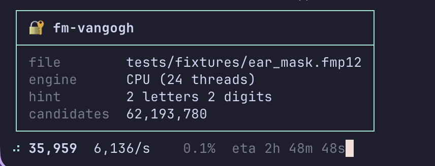
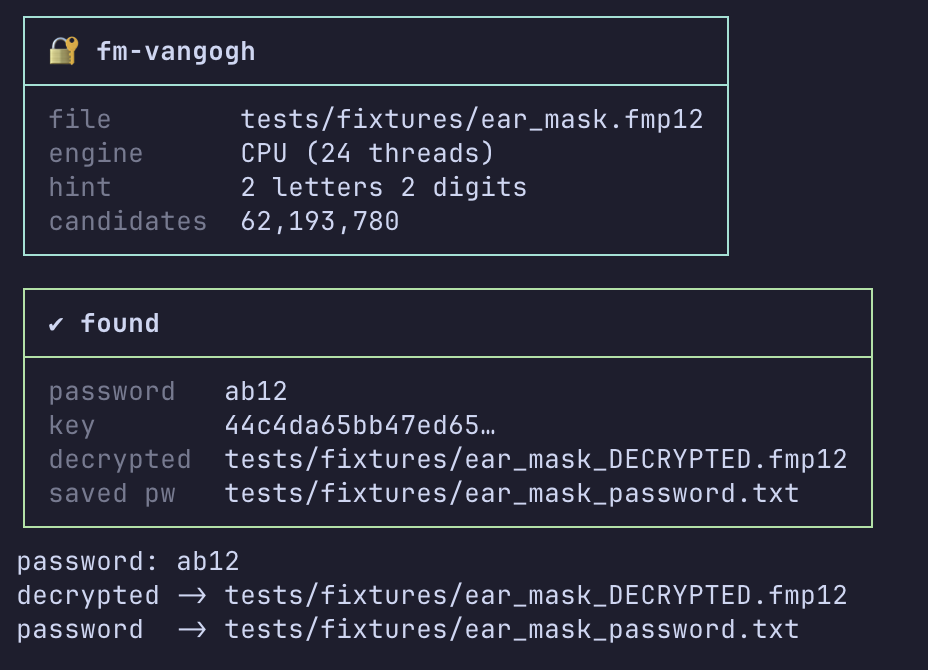

# fm-vangogh

Recover and decrypt FileMaker Encryption At Rest (EAR) `.fmp12` files you own:
decrypt with a known password, or crack it with a wordlist, rule mutations, or a
mask. Single self-contained Rust binary. CPU by default, or GPU (wgpu: Metal on
macOS, Vulkan on NVIDIA/Linux). A Python reference POC is in `python/`.

## Screenshots

Live progress while cracking (rate, percent, ETA), then the result when the
password is found:

## Authorization

Use this only on FileMaker databases you own and are authorised to administer. It
does the same offline recovery FileMaker's own tools do, given the password.

## Install

Download the binary for your platform from the latest release (built for
linux x86_64/arm64, macOS arm64, and windows x86_64), then put it on your
PATH. It is a single self-contained file: no runtime to install.

On macOS the binary is unsigned, so the first run is blocked by Gatekeeper. After extracting, make it executable and clear the quarantine flag, then run it:

    chmod +x fm-vangogh && xattr -dr com.apple.quarantine fm-vangogh

(Or right-click the binary and choose Open, or allow it under Privacy & Security.)
Installing via `cargo install` or Homebrew avoids this, as those are not quarantined.

On Windows, use Windows Terminal or PowerShell for the styled output; the legacy
Command Prompt (cmd.exe) may not render the colours and boxes.

Or build from source (needs the Rust toolchain):

    cargo build --release        # -> target/release/fm-vangogh
    # or install it onto your PATH:
    cargo install --path .

## Commands

| Command | What it does |
|---|---|
| `fm-vangogh info <file>` | Is it EAR-encrypted? Show salt, sectors, and the cleartext hint. |
| `fm-vangogh devices` | Show CPU threads and visible GPU adapters (so you know what `--gpu` will use). |
| `fm-vangogh decrypt <file> -p <pw> [-o <out>]` | Decrypt with a known password. |
| `fm-vangogh crack <file> [options]` | Search for the password. On a TTY: a styled live panel (header, rate/ETA, result box); piped output stays plain. |

## `crack` options

| Option | Meaning |
|---|---|
| `-w, --wordlist <FILE>` | Use your own list (one per line). Default: a built-in list of 265 common passwords. |
| `--mods` | Expand each word: case, leet, and appended digits / years (1990-2035) / suffixes. `dragon` -> `Dragon2024`. |
| `--mask` | Brute force every string of a length over `--charset`, instead of a wordlist. |
| `--charset <SET>` | Alphabet for `--mask`: `lower`, `upper`, `digits`, `alnum` (default), `all`, or literal chars like `ab12`. |
| `--min <N>` / `--max <N>` | `--mask` length range (default 1-4). Search size = charset^length, so keep it tight or use `--gpu`. |
| `-j, --jobs <N>` | CPU worker threads (default: all cores). CPU engine only. |
| `--gpu` | Run key derivation on the GPU. Much faster for big runs. Passwords over 32 chars fall back to CPU. |
| `--decrypt` | On success, write `<file>_DECRYPTED.fmp12` and `<file>_password.txt` next to the input (never overwriting). |

The built-in wordlist (no `-w`) is 265 common passwords, `dragon` among them. With
`--mods` that one entry becomes `Dragon`, `DRAGON`, `dr@g0n`, `Dragon2024`, and so on.

## Examples

    fm-vangogh info secret.fmp12
    fm-vangogh decrypt secret.fmp12 -p 'hunter2' -o plain.fmp12

    fm-vangogh crack secret.fmp12                               # built-in list, CPU
    fm-vangogh crack secret.fmp12 --mods --gpu                  # + mutations, on the GPU
    fm-vangogh crack secret.fmp12 -w ~/rockyou.txt --decrypt    # your list, decrypt on hit
    fm-vangogh crack secret.fmp12 --mask --charset digits --min 1 --max 6 --gpu  # all PINs up to 6

## Develop

    cargo test --release     # full matrix: every modifier on CPU and GPU, incl. long passwords
    ./scripts/bench.sh       # GPU vs CPU throughput

Test fixtures are real EAR files (`tests/fixtures/*.fmp12`) made with FileMaker's
Developer Tool, one per search type and two long-password cases. The Python POC in
`python/` is the reference the Rust port is checked against.

## How it works

EAR derives the AES-256 key with PBKDF2-HMAC-SHA1 (18000 iterations), so each guess
costs one PBKDF2 plus a short trial decrypt. EAR stores no verifier, so a guess is
confirmed by decrypting a sector: a wrong key gives near-random bytes, a correct one
structured data with FileMaker's version string. Details in `docs/EAR.md`; GPU design
in `docs/GPU.md`.

## License

MIT. See `LICENSE`.
